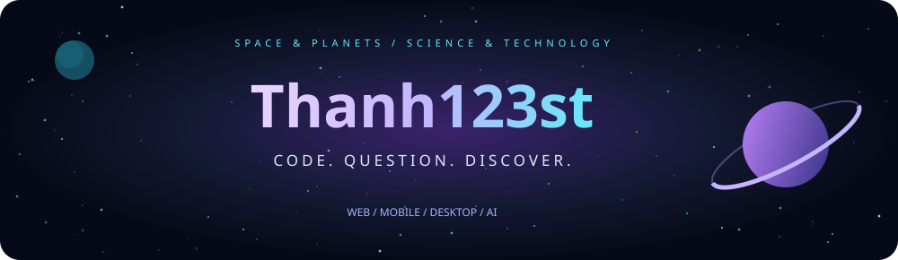
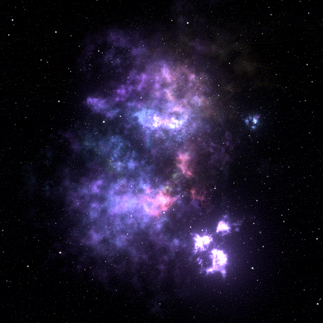
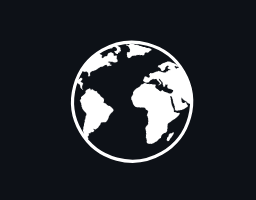
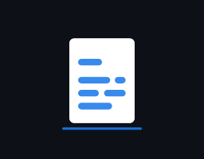
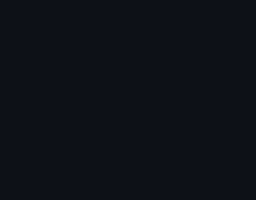
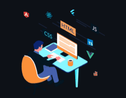
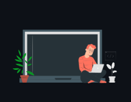
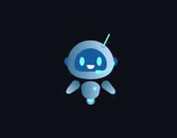
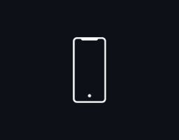

<table>
<tr>
<td align="center" valign="middle" width="60%">

</td>
<td align="center" valign="middle" width="40%">

</td>
</tr>
</table>

 

 

### A curious mind, looking at the bigger picture.

<table>
<tr>
<td align="center" width="42%">

</td>
<td align="left" width="58%">
<h2>Hey, I'm Thanh123st </h2>

I like turning ideas into apps, trying new technology, and figuring out how things connect.

 Space, planets &amp; the universe  Science, technology &amp; new possibilities  AI experiments &amp; hands-on learning  Economics, systems &amp; the bigger picture

Small experiments. Endless curiosity.

</td>
</tr>
</table>

   

 

### Different tools. Connected possibilities.

<table>
<tr>
<td align="center" width="33%"><h3> Languages</h3>

</td>
<td align="center" width="33%"><h3> Interfaces & Apps</h3>

</td>
<td align="center" width="33%"><h3> Services & Systems</h3>

</td>
</tr>
<tr>
<td align="center" width="33%"><h3> Data & Caching</h3>

</td>
<td align="center" width="33%"><h3> App Extras</h3>
  
</td>
<td align="center" width="33%"><h3> Tools & Deployment</h3>

</td>
</tr>
</table>

 

### A little science. A little code. A lot to explore.

<table>
<tr>
<td align="center" width="35%">

</td>
<td align="center" width="65%">
<h3> AI &amp; Data Playground</h3>

Notebooks · Models · Data · LLM APIs

 

  

Prompt experiments · Excel data processing · Exploring ideas with AI

</td>
</tr>
</table>

 

### Pick a destination. Explore something I have built.

<table>
<tr>
<td align="center" width="33%">

<h3>CEHub</h3>
English learning
  </td>
<td align="center" width="33%">

<h3>Tourism AI</h3>
Travel &amp; discovery
  </td>
<td align="center" width="33%">

<h3>Science Journal</h3>
Research &amp; publishing
  </td>
</tr>
<tr>
<td align="center" width="33%">

<h3>Patient Portal</h3>
Patient experience
  </td>
<td align="center" width="33%">

<h3>Staff Platform</h3>
Web &amp; desktop
  </td>
<td align="center" width="33%">

<h3>Hospital API</h3>
Services &amp; API docs
  </td>
</tr>
<tr>
<td align="center" width="33%">

<h3>Charity Ledger</h3>
Transparent fundraising
  </td>
<td align="center" width="33%">

<h3>Thread Town</h3>
Social &amp; conversations
  </td>
<td align="center" width="33%">

<h3>Attendance App</h3>
React Native &amp; Expo
  </td>
</tr>
</table>

 

###  Connect With Me

<table>
<tr>
<td align="center" width="38%">

<h3>LEO / THE LION</h3>
My zodiac constellation.
</td>
<td align="center" width="62%">
<h3> A signal from your side?</h3>

Say hello. Share an idea. Talk technology.

  
  &nbsp;&nbsp;&nbsp;
  
  &nbsp;&nbsp;&nbsp;
  

Always curious about what comes next.

</td>
</tr>
</table>

 

Animation sources &amp; icon license

 
<a href="https://giphy.com/gifs/MXQnyEQwBJ6eTj90L5">Violet nebula</a> · <a href="https://giphy.com/gifs/sun-ctGFLebG1AqK4">Sun</a> / GIPHY 
<a href="https://giphy.com/gifs/kippoapp-dating-astrology-kippo-m5t96aAfEAuObIMVoz">Leo constellation</a> — Kippo / GIPHY 
<a href="https://lottiefiles.com/free-animation/donaciones-xMlHVtkbGJ">Donation animation</a> / LottieFiles 
 Project motion: existing Lottie artwork rendered for a dark background. <a href="https://lottiefiles.com/free-animation/hospital-H0XKUCP5gs">Patient</a> · <a href="https://lottiefiles.com/free-animation/globe-transparent-BgOdIoFKnp">Tourism</a> · <a href="https://lottiefiles.com/free-animation/live-chatbot-umPtBW5amb">Thread</a> · <a href="https://lottiefiles.com/free-animation/rotate-phone-kPnav83TO4">Attendance</a> <a href="https://lottiefiles.com/free-animation/document-ocr-scan-xjHvcgGQ7G">Science Journal document animation</a> / LottieFiles Education and coding animations reused from the personal website asset collection. Icons: Lucide · <a href="assets/icons/LICENSE">ISC license</a>

 

